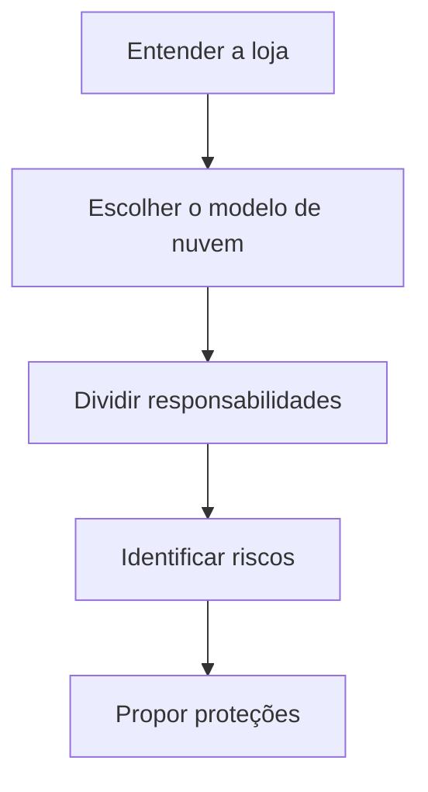

# Segurança em Nuvem: Como Proteger uma Loja Virtual

## Sobre o estudo

Imagine uma pequena empresa que vende roupas personalizadas e itens de decoração pela internet. A loja quer alcançar clientes de outros países e precisa manter o site funcionando e os dados dos compradores protegidos.

Neste estudo de caso da **Cisco Networking Academy (NetAcad)**, analisei o que essa loja precisa para funcionar na nuvem, quais problemas de segurança podem surgir e como a empresa pode se proteger.

---

## O que a loja precisa?

| Necessidade | Na prática |
|---|---|
| Mostrar produtos | Exibir fotos, preços e descrições |
| Receber pedidos | Registrar compras e acompanhar entregas |
| Atender clientes | Responder dúvidas e resolver problemas |
| Divulgar ofertas | Apresentar promoções e campanhas |
| Acompanhar vendas | Entender o que está vendendo e melhorar o negócio |

---

## Qual foi a solução proposta?

A proposta é usar uma **nuvem pública**, ou seja, contratar recursos de computação de uma empresa especializada em vez de manter servidores próprios.

Para hospedar a loja, escolhi estudar o modelo **PaaS (Plataforma como Serviço)**. Nele, a empresa que oferece a nuvem cuida de parte da estrutura técnica, enquanto a loja se concentra em desenvolver e cuidar do seu site.

**Um exemplo simples:** é como alugar um espaço comercial já preparado com eletricidade e manutenção do prédio. A loja ainda precisa organizar seus produtos, atender os clientes e cuidar do que acontece dentro dela.

O PaaS faz sentido quando a empresa quer uma loja personalizada e tem profissionais para desenvolvê-la. Se a prioridade for começar rapidamente com uma loja pronta, um serviço **SaaS (Software como Serviço)** também pode ser uma opção.

---

## Quem é responsável pela segurança?

Na nuvem, a segurança é uma **responsabilidade compartilhada**: a empresa que fornece o serviço cuida de parte da estrutura, mas a loja também tem tarefas importantes.

| Quem? | Pelo que cuida? |
|---|---|
| Provedora de nuvem | Servidores físicos, instalações e manutenção do sistema operacional gerenciado no PaaS |
| Loja virtual | Dados dos clientes, contas dos funcionários, permissões e segurança do próprio site |
| Ambas | Alguns controles da aplicação e da rede, conforme o serviço contratado |

Por exemplo, mesmo que os servidores estejam protegidos, um funcionário com acesso maior do que precisa pode acabar vendo ou alterando informações indevidas. **A loja precisa decidir quem pode acessar cada informação.**

---

## Quais problemas podem acontecer?

Estas são **situações possíveis**, usadas para pensar na proteção da loja; não são incidentes reais.

| Risco | Exemplo do dia a dia |
|---|---|
| Vazamento de dados | Informações de clientes ficam visíveis para pessoas não autorizadas |
| Roubo de conta | Alguém consegue entrar na conta de um administrador |
| Acesso além do necessário | Um atendente consegue alterar configurações que não fazem parte do seu trabalho |
| Falhas no site | Um erro permite que um cliente veja o pedido de outra pessoa |
| Site fora do ar | Um ataque sobrecarrega a loja e impede novas compras |

---

## Como a loja pode se proteger?

| Medida | Explicação simples |
|---|---|
| **Verificação em duas etapas (MFA)** | Pedir uma confirmação extra para entrar em contas importantes |
| **Permissões por função (IAM)** | Dar a cada funcionário acesso apenas ao que precisa usar |
| **Proteção dos dados** | Usar conexões seguras e criptografia para dificultar o acesso indevido às informações |
| **Cuidados com o site** | Corrigir falhas e aplicar proteções contra ataques |
| **Monitoramento e cópias de segurança** | Acompanhar sinais de problemas e preparar formas de recuperar informações |

---

## Como organizei a análise

1. Entendi quais funções a loja precisa oferecer.
2. Comparei formas de usar a nuvem e propus o PaaS.
3. Separei as responsabilidades da loja e da provedora.
4. Listei riscos que poderiam afetar o negócio.
5. Relacionei cada tipo de risco a formas de proteção.

---

---

## O que aprendi?

O principal aprendizado foi entender que **colocar um sistema na nuvem não significa deixar toda a segurança nas mãos da provedora**.

Também percebi como a gestão de acessos faz diferença: cada pessoa deve ter apenas as permissões necessárias para trabalhar. Esses cuidados se relacionam ao **Suporte de TI**, à **Gestão de Identidades e Acessos (IAM)** e à **Cibersegurança**.

---

## Entendendo os termos

| Termo | Significado |
|---|---|
| **Nuvem pública** | Recursos de tecnologia contratados pela internet de uma empresa especializada |
| **PaaS** | Serviço que oferece uma base pronta para desenvolver e hospedar aplicações |
| **SaaS** | Programa pronto para usar pela internet |
| **IAM** | Organização de quem pode entrar em cada sistema e do que pode fazer nele |
| **MFA** | Uma confirmação extra de identidade, além da senha |
| **Criptografia** | Forma de transformar informações para dificultar a leitura por pessoas não autorizadas |

---

## Onde esse conhecimento pode ser usado?

### Uma loja em crescimento

Uma loja virtual contratou novos atendentes. Para facilitar, todos começaram a usar a mesma conta de administrador. O problema é que essa conta permite consultar pedidos **e** mudar configurações importantes.

Um profissional de TI propõe criar uma conta para cada funcionário e separar os acessos: atendentes podem consultar pedidos, enquanto somente responsáveis autorizados podem alterar configurações. As contas administrativas também passam a exigir uma confirmação extra no login.

**Resultado esperado:** menos risco de alterações indevidas e mais facilidade para descobrir quem realizou cada ação.

*Este é um exemplo fictício para mostrar como os conceitos do estudo podem ser usados no dia a dia.*

